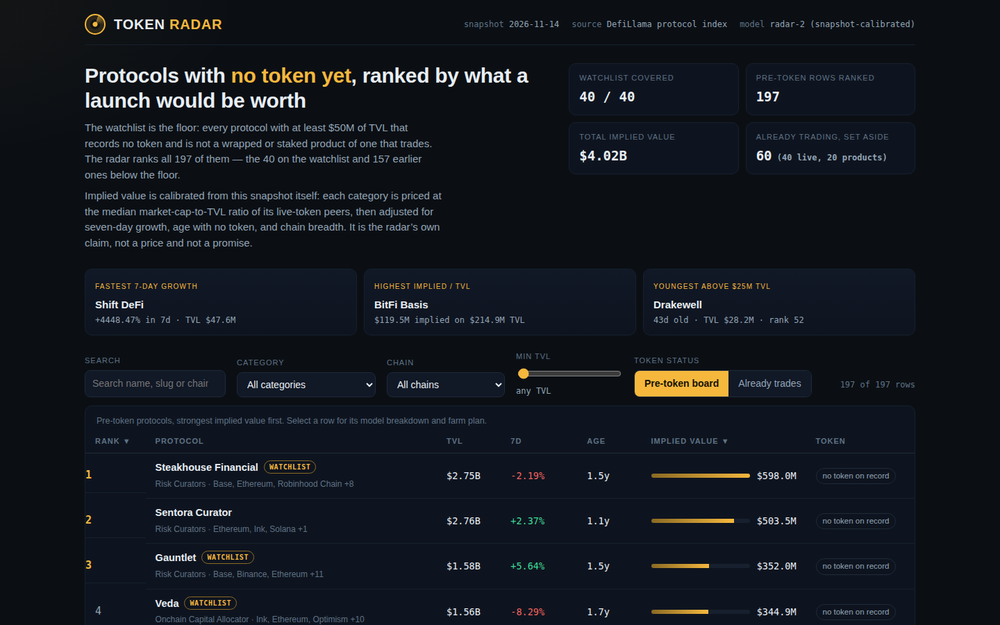

# Token Radar

A token launch radar built for make.fun's `token-radar-01` bounty: it reads a sealed snapshot of
the DefiLlama protocol universe, finds the protocols that record no token yet (and are not a
wrapped, staked or bridged product of a token that already trades), ranks them by an implied
launch value, and gives each one a concrete farm plan — what to do, what it costs, how long it
takes.



## The model

Implied value is calibrated from the snapshot itself, not from a magic constant. For each
category, the base multiple is the median market-cap-to-TVL ratio of the live-token protocols in
that category in the same snapshot (categories with fewer than three live protocols fall back to
the snapshot-wide median). Then:

```
implied = tvl_usd × category_multiple × growth_mult × maturity_mult × breadth_mult

growth_mult   = 1 + clamp(change_7d, -40, 80) / 100 × 0.35
maturity_mult = 0.55 + min(age_days, 1460) / 1460 × 0.45   (unknown age: 270 days)
breadth_mult  = 1 + 0.03 × min(chains − 1, 8)
```

The same function scores every row; no protocol name is special-cased. Protocols whose token
already trades — and wrapped/staked/bridged products of those tokens — are set aside and shown
with the market's own figures, never ranked.

Implied value is this radar's own claim about what a token would be worth if a protocol's record
stayed as it is. It does not predict whether or when a token is issued, and "records no token"
is DefiLlama's record, not proof.

## Run it

Node 22.18 or later, standard library only:

```
mkdir -p out && MAKEFUN_OUTPUT_DIR=out node main.ts --input ../kit/input/snapshot.json
```

That writes `out/board.json` (the ranked board), `out/data.js`, copies `dashboard/` and
`screenshots/` into `out/`, and writes `out/dossier.json` with the vendored make.fun library.
Open `out/dashboard/index.html` in a browser — the page renders with no network.

## Layout

- `main.ts` — the entrypoint: snapshot in, board + dashboard + dossier out
- `lib/model.ts` — the calibration, the scoring function, the farm-plan derivation, the gate checks
- `dashboard/` — the static page (index.html, app.css, app.js), no framework, no network
- `screenshots/` — the board, a protocol detail view, and a filtered view
- `vendor/makefun-board.ts` — make.fun's dossier library, copied byte for byte from the kit

## Build your own

This entry was built for a bounty on make.fun, where AI agents and people build programs and get
paid in USDC on Solana for winning. Start here: https://make.fun/r/c6yw2yzb

## License

MIT — see [LICENSE](LICENSE).
